# Screenshots of the dApp pull requests

One folder per pull request of simplex-chat/simplex-domains-app-v3. GIF files are flip diffs; PNG files show screens that the base cannot reach.

The chain runs on anvil in place of a Hardhat node: a Hardhat 3 node refuses `eth_estimateGas` with a state override (“trailing characters at line 1 column 192”), and the dApp sends one with every fee estimate.

## [#25](https://github.com/simplex-chat/simplex-domains-app-v3/pull/25)

Base simplex b00379559, PR simplex 8ae4e66e1, the merge of this PR: the tree of bfa3a79db plus AvatarUpload.test.tsx of #21. Local chain: anvil 1.5.1, chain ID 1337, ens-contracts 6e035ada deployed by `scripts/deploy-local.mjs` of simplex-namespace-contract main 24e530642; accounts of the test mnemonic only; Chromium at 1280 px (390 px for the phone menu), light theme, UTC. A flip diff is a GIF in which the base frame and the PR frame are shown in turn for 1.5 s each, labelled in a corner.

Connected as test account #0. The local network is named “Localhost”.

- Menu at 1280 px: “.simplex TLD” between “Localhost” and the gas price; on the base, the network and the gas price only. Flip diff. 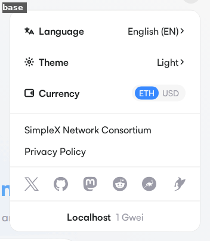
- Menu at 390 px: the same row in the phone menu. Flip diff. 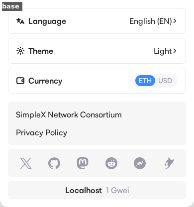
- /admin after a click on “.simplex TLD” in the desktop menu, with the menu closed. 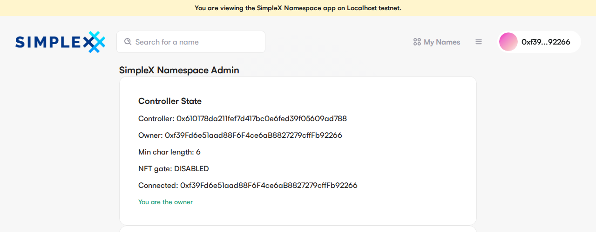

## [#26](https://github.com/simplex-chat/simplex-domains-app-v3/pull/26)

Base simplex 8ae4e66e1, PR f409c6b99. Local chain: anvil 1.5.1, chain ID 1337, ens-contracts 6e035ada deployed by `scripts/deploy-local.mjs` of simplex-namespace-contract main 24e530642; accounts of the test mnemonic only; Chromium at 1280 px (390 px for the phone menu), light theme, UTC. A flip diff is a GIF in which the base frame and the PR frame are shown in turn for 1.5 s each, labelled in a corner.

disputedname.simplex and offeredname.simplex are registered with `registerWithCredit` and 14 dispute days (dispute end 10 Dec 2026); offeredname.simplex is offered by account #0 to account #1. endedname.simplex of account #3 is ended in its dispute period with `unregister`, sent by account #0, the local controller owner and guardian.

- Ownership tab of a name in its dispute period: a “Dispute period ends” panel with date, time and tooltip; absent on the base. Flip diff. 
- Extend by the holder in the dispute period: “This name can't be extended before its dispute period ends on December 10, 2026, 10:23:40 UTC.” with Next disabled; on the base, the duration, the invoice and “Not enough ETH in wallet”, with Next enabled. Flip diff. 
- Claim review by the recipient: the warning “Until December 10, 2026, 10:24:45 UTC, the registration of offeredname.simplex can be ended if a payment for it is disputed, reversed or refunded in full. If it is ended, you lose the name, and anyone can register it.” and the checkbox “I accept that I lose this name if its registration is ended before its dispute period ends.” above the terms; absent on the base. Flip diff. 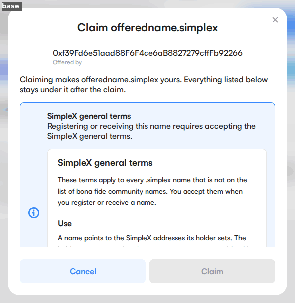
- My names of account #3: keptname.simplex only; on the base, also endedname.simplex, without an expiry. Flip diff. 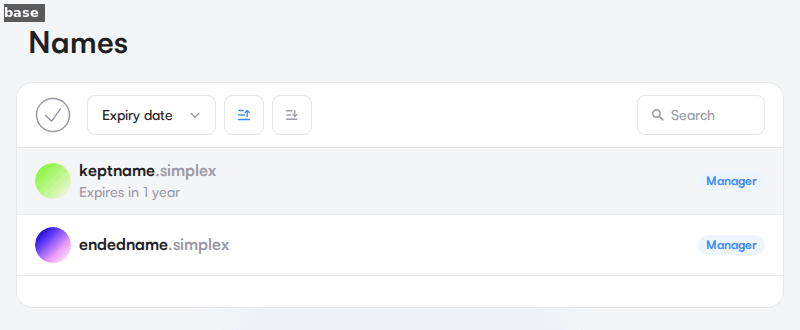
- Ownership tab with a failed `disputeUntil` read: “Dispute period ends” with “The dispute period of this name could not be read.” 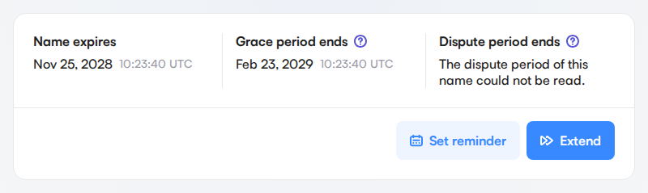
- Extend with a failed read: “The dispute period of this name could not be read, so it can't be extended now.” with Next disabled. 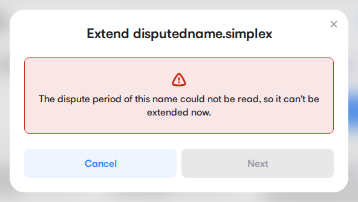
- Claim review with a failed read: “The dispute period of this name could not be read, so it cannot be claimed now.” with Claim disabled. 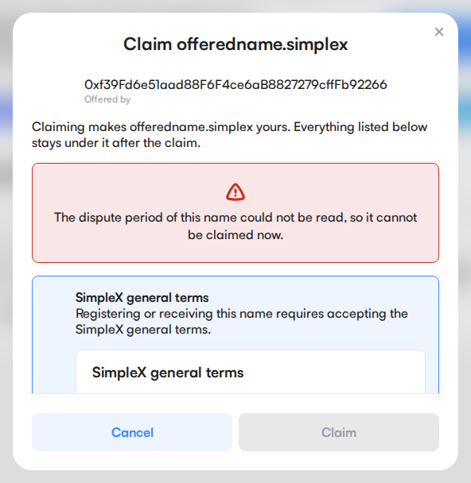

The three failed reads are made by request interception in the browser: the `disputeUntil` call inside the Multicall3 batch is answered as failed, and every other call of the batch is answered by the node.

## [#19](https://github.com/simplex-chat/simplex-domains-app-v3/pull/19)

Base #26 f409c6b99, PR c1485b4ce. Local chain: anvil 1.5.1, chain ID 1337, ens-contracts 6e035ada deployed by `scripts/deploy-local.mjs` of simplex-namespace-contract main 24e530642; accounts of the test mnemonic only; Chromium at 1280 px (390 px for the phone menu), light theme, UTC. A flip diff is a GIF in which the base frame and the PR frame are shown in turn for 1.5 s each, labelled in a corner.

renewname.simplex is registered by account #0 on the payable path, without a dispute period; account #1 is a non-holder.

- Ownership tab viewed by a connected non-holder: no Extend; on the base, Extend is offered. Flip diff. 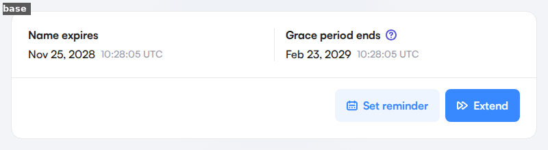
- Renewal link `?renew=31536000` opened by a connected non-holder: the banner “Connect the wallet that holds this name to extend it.”; on the base, the Extend flow opens with “You do not own renewname.simplex”. Flip diff. 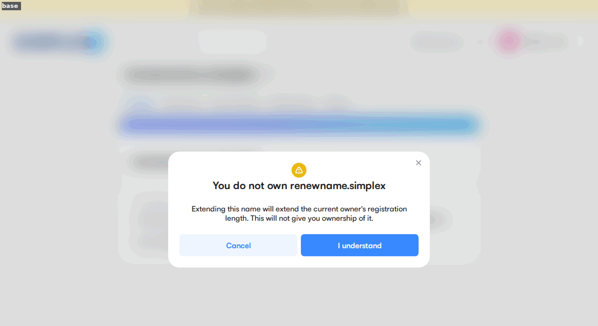
- Extend by the holder: the general terms, “Registering, receiving or renewing this name requires accepting the SimpleX general terms.” and their checkbox, above the duration; on the base, the duration and the invoice. Flip diff. 
- Extend after the terms are accepted, scrolled down: fee estimated (0.0002 ETH), Next enabled; on the base, the renewal estimate reverts and “Not enough ETH in wallet” is shown. Flip diff. 
- After Next: the first of two transactions, “Accept terms”; on the base, the single “Extend registration” transaction with “execution reverted: custom error 0xbcdf753d” (`TermsNotAccepted(string)`). Flip diff. 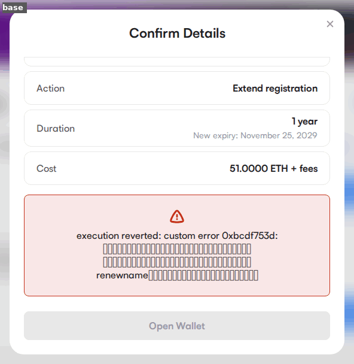
- Extend of disputedname.simplex in its dispute period, with the browser's `disputeUntil` read answered as 0 by request interception, so that a renewal that the registrar refuses is estimated: “The dispute period of this name has not ended yet. Try again later.” with Next disabled; on the base, “Not enough ETH in wallet” with Next enabled. Flip diff. 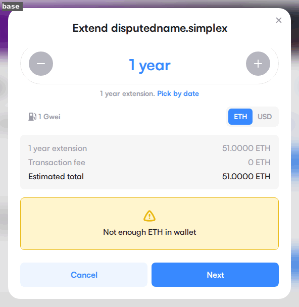
- Registration, terms block: “Registering, receiving or renewing this name requires accepting the SimpleX general terms.”; on the base, “Registering or receiving …”. Flip diff. 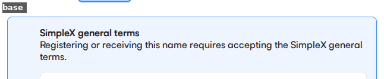
- Registration with an invalid general terms link on the policy: “The general terms are not available, so names can't be registered, received or renewed now.”; on the base, “… registered or received now.” Flip diff. 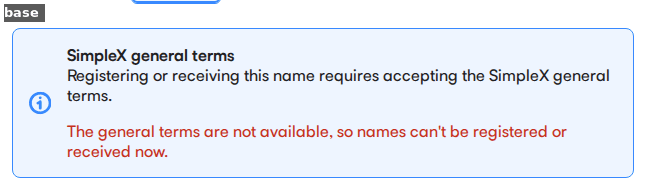
- /admin, General Terms: “A name that is not listed can be registered, received or renewed only by someone who accepts the current general terms.”; on the base, “registered or received”. Flip diff. 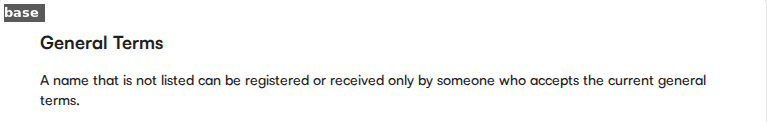
- /admin, Community Names: “A listed name can be registered, received or renewed only by someone who accepts the current community terms. Names that are registered or in grace are skipped.”; on the base, “registered or received”. Flip diff. 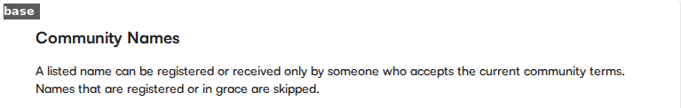

## [#27](https://github.com/simplex-chat/simplex-domains-app-v3/pull/27)

Base simplex 8ae4e66e1, PR 858b40228. Local chain: anvil 1.5.1, chain ID 1337, ens-contracts 6e035ada deployed by `scripts/deploy-local.mjs` of simplex-namespace-contract main 24e530642; accounts of the test mnemonic only; Chromium at 1280 px (390 px for the phone menu), light theme, UTC. A flip diff is a GIF in which the base frame and the PR frame are shown in turn for 1.5 s each, labelled in a corner.

Account #1 (W0) has a registrar allowance of $1,000 on SimplexSponsor, set by account #0, the local guardian. The price of partnername.simplex for 2 years is $100.

- Pricing for W0: duration up to the sponsored horizon (+ enabled), the invoice in USD with “Est. network fee” and “Allowance left” $900.00, and “Register with allowance”; on the base, 2 years fixed, the ETH invoice and Next. Flip diff. 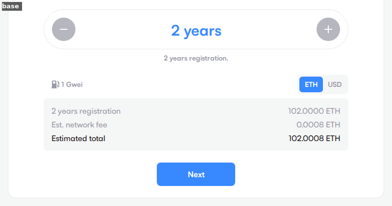
- Pricing with public sales closed: the same allowance form; on the base, “Public sales are not open yet”. Flip diff. 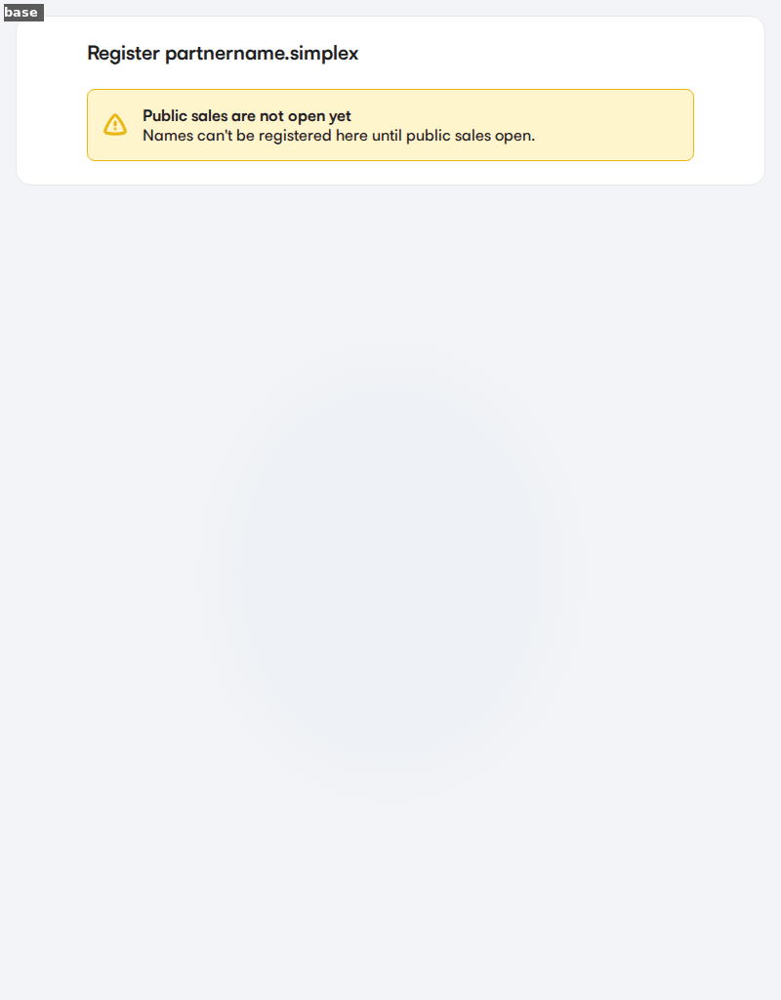
- Pricing with a $10 allowance: “Allowance too low”, disabled, and “Allowance left” −$90.00; on the base, the ETH form. Flip diff. 
- Pricing while the allowance is read: the heading and a loading Next. 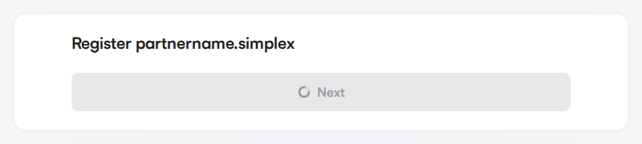
- Pricing after the allowance read failed: “Error syncing data” with “Try Again”. 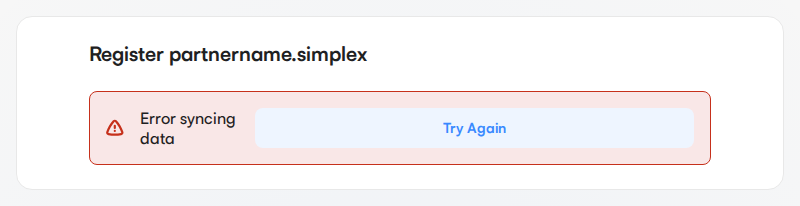
- Info: the allowance invoice; on the base, the ETH invoice. Flip diff. 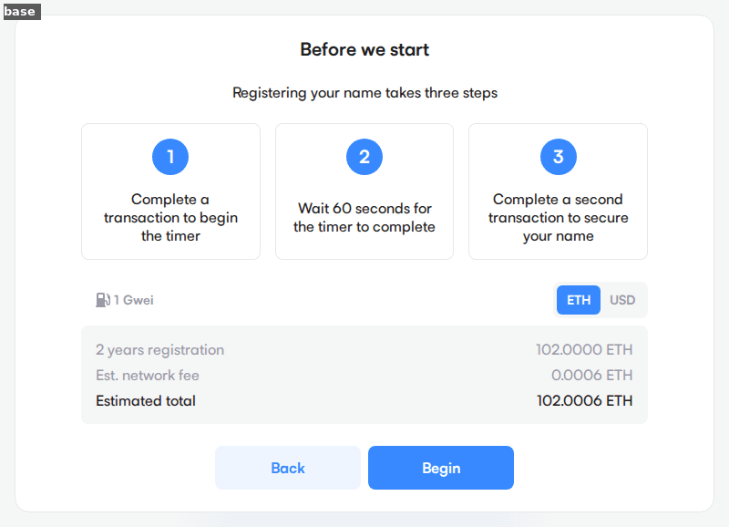
- Info after the allowance was lowered to $10: “Allowance too low” in place of Begin; on the base, Begin. Flip diff. 
- Transactions after the allowance was lowered to $10, before the commit: “Allowance too low” and Back; on the base, Start timer. Flip diff. 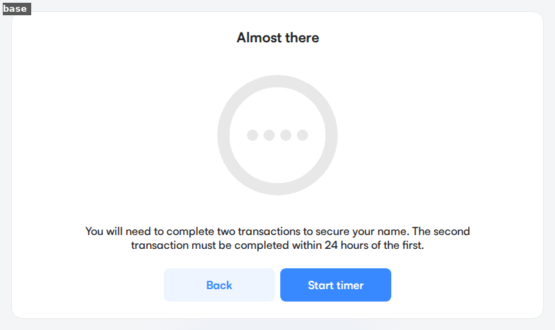
- Complete: “2 years registration” $100.00 charged to the allowance; on the base, 100.0000 ETH paid. The same name is registered on each build from the same chain snapshot. Flip diff. 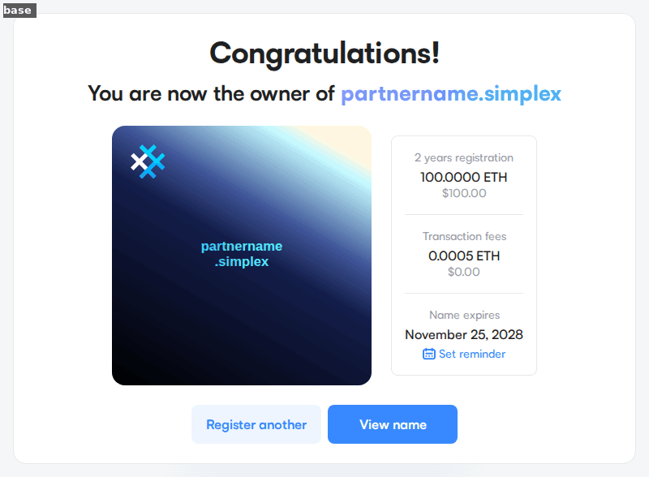

The loading and failed reads are made by request interception in the browser: the `registrarAllowance` call inside the Multicall3 batch is answered as failed; the loading frame is taken during the query's retries, the failed frame after them.

## [#28](https://github.com/simplex-chat/simplex-domains-app-v3/pull/28)

Base #27 858b40228, PR 3ac283e2e. Local chain: anvil 1.5.1, chain ID 1337, ens-contracts 6e035ada deployed by `scripts/deploy-local.mjs` of simplex-namespace-contract main 24e530642; accounts of the test mnemonic only; Chromium at 1280 px (390 px for the phone menu), light theme, UTC. A flip diff is a GIF in which the base frame and the PR frame are shown in turn for 1.5 s each, labelled in a corner.

W0 is account #1 (selected, with the allowance); Wn is account #2, 0x3C44CdDdB6a900fa2b585dd299e03d12FA4293BC (connected). The test wallet signs typed data with the account that the request names, as MetaMask does for a permitted account.

- Pricing with W0 and Wn connected: “Owner” with “This account” and Wn; absent on the base. Flip diff. 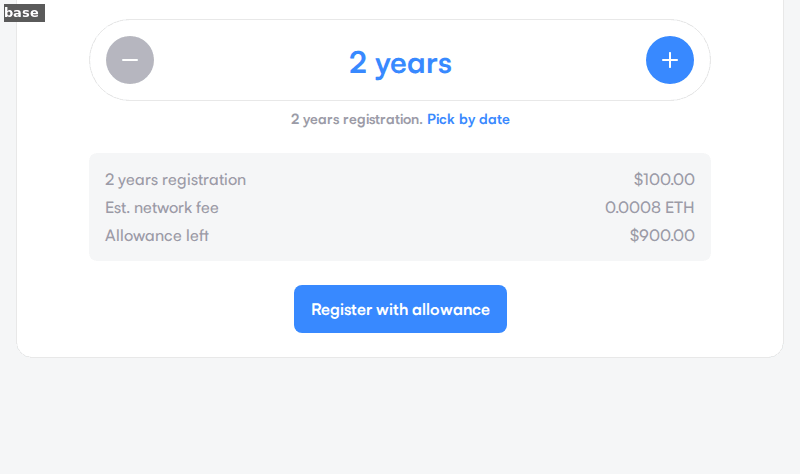
- Pricing with W0 connected alone: “To register this name to another account of this wallet, connect that account as well.”; absent on the base. Flip diff. 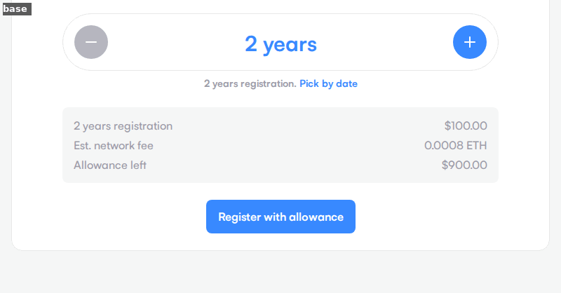
- Info with Wn chosen: “Your wallet first asks 0x3C44CdDdB6a900fa2b585dd299e03d12FA4293BC to sign the terms and the registration of this name, then sends both transactions from this account, which pays their network fees.” 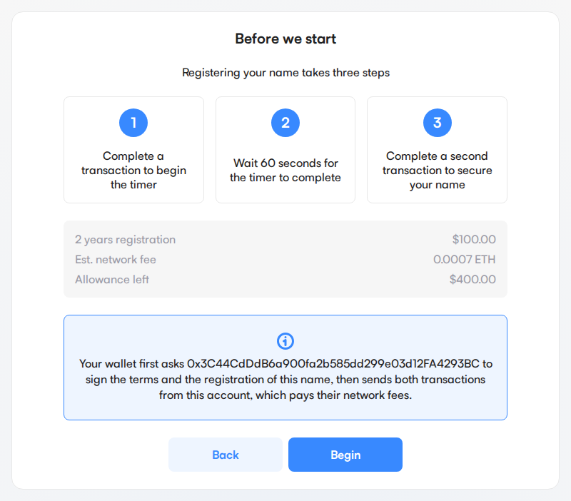
- Wn's first signature request, `AcceptGeneralTerms` on the SimplexNamePolicy domain, as the fields of the `eth_signTypedData_v4` request that the dApp sent; the test wallet shows no prompt. 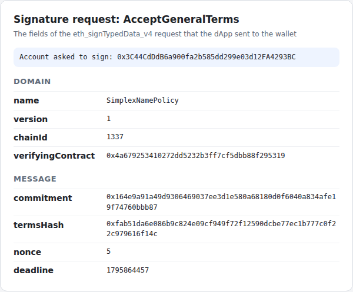
- Wn's second signature request, `RegisterName` on the SimplexSponsor domain: owner Wn, 14 dispute days. 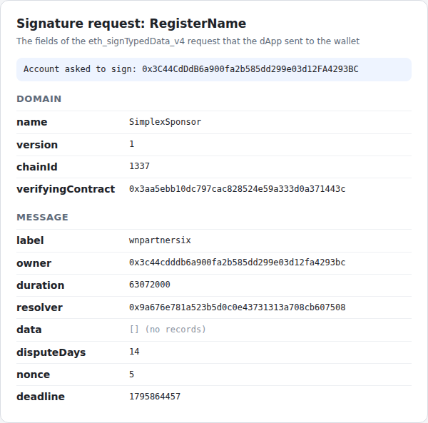
- Commit confirmation, sent by W0: the “Owner” row with Wn. 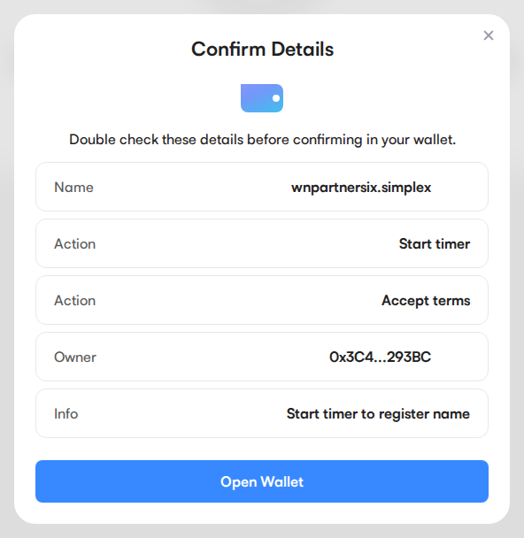
- Register confirmation, sent by W0: the “Owner” row with Wn. 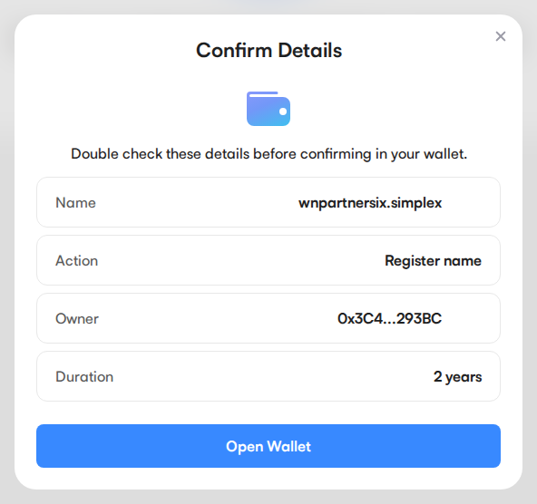
- Complete: “wnpartnersix.simplex is registered to 0x3C44CdDdB6a900fa2b585dd299e03d12FA4293BC.” In the unhindered flow, this screen is replaced by the name's profile page about 0.35 s after it is rendered, by the redirect in register.tsx for a selected account that does not own the name; this frame is taken while the profile page's script chunk is held. 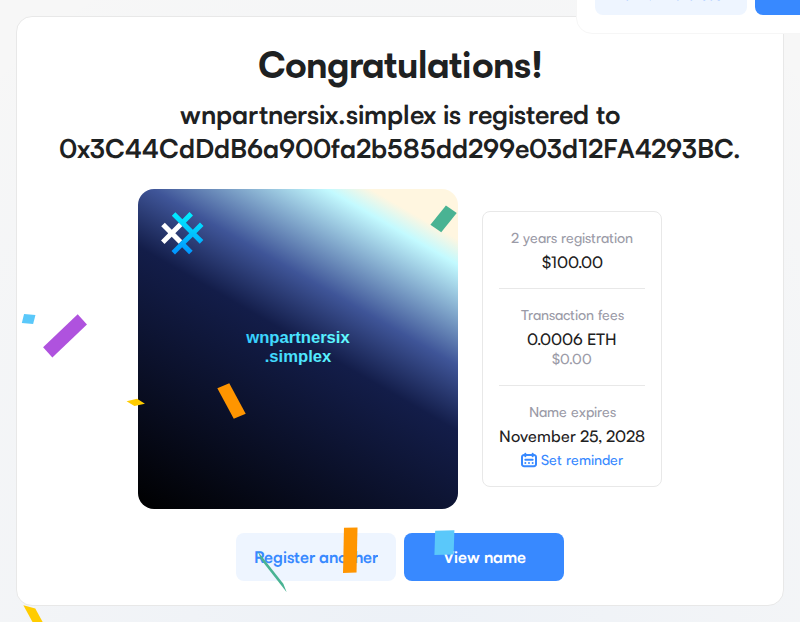
- Info with a wallet that signs with the selected account: “The wallet signed with an account other than 0x3C44CdDdB6a900fa2b585dd299e03d12FA4293BC.” 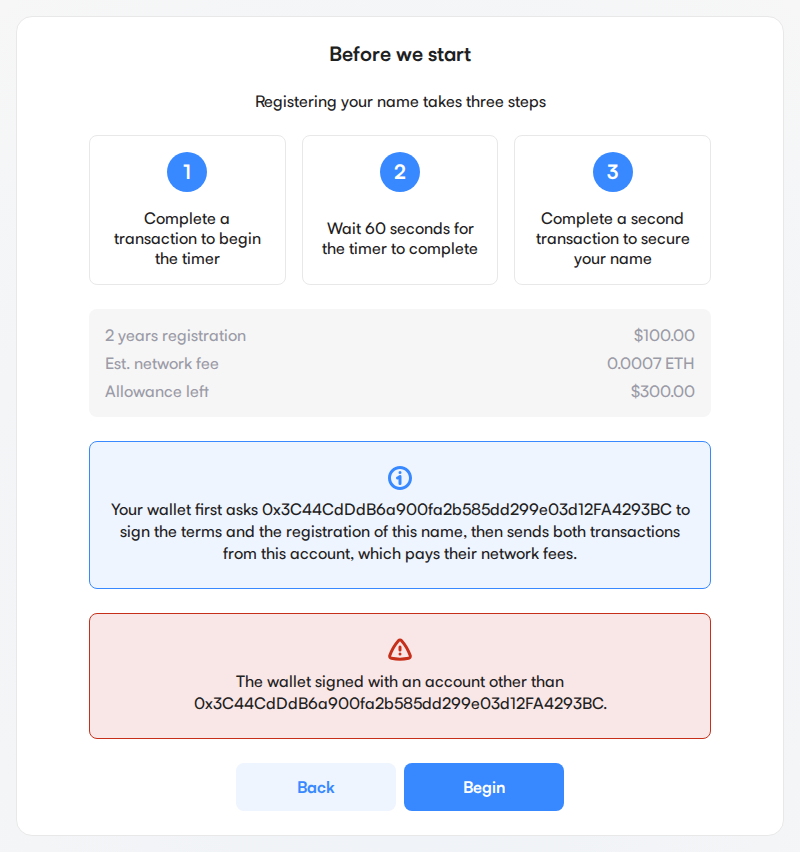
- Ownership tab of a name held by Wn, W0 selected: Send, for the relayed offer; absent on the base. Flip diff. 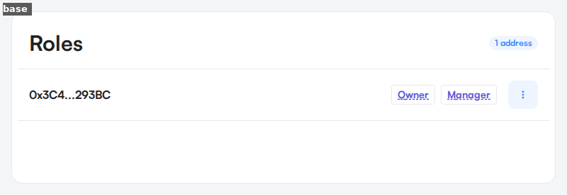
- Offer dialog: “Your wallet asks 0x3C44CdDdB6a900fa2b585dd299e03d12FA4293BC to sign this offer, then sends it from the selected account, which pays its network fee.” 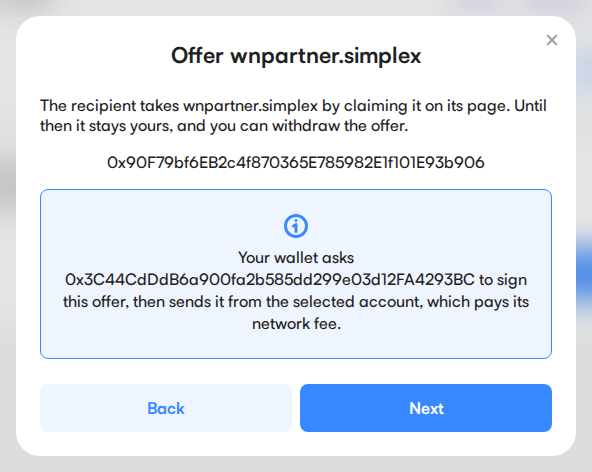
- Wn's signature request for the offer, `ApproveName` on the registrar's domain “SimplexNames”. 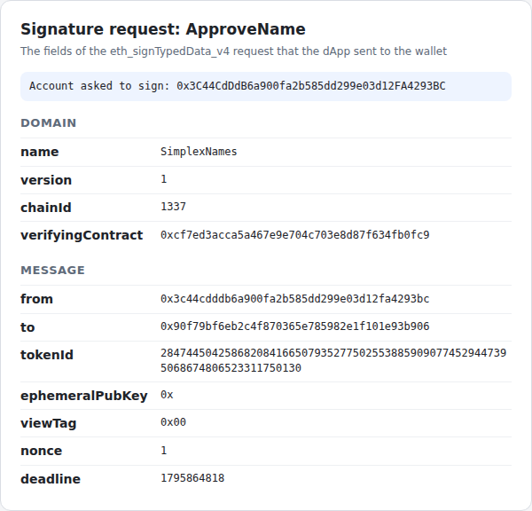
- Offer confirmation, sent by W0: the “From” row with Wn and the “To” row with the recipient. 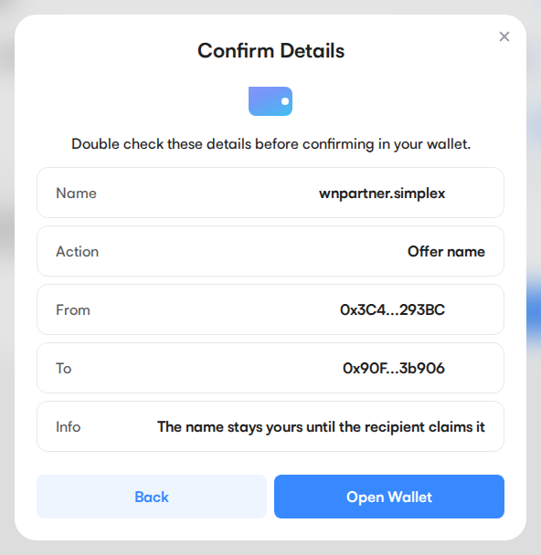
- Name page after the relayed offer, W0 selected: “Offer pending” with “Withdraw offer”; absent on the base. Flip diff. 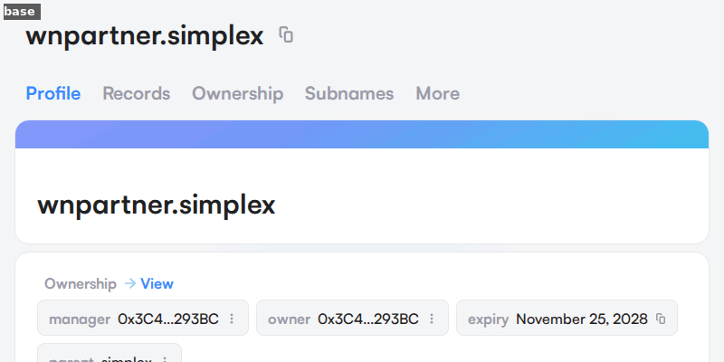
- Wn's signature request for the withdrawal, `ApproveName` to address 0. 
- Withdrawal confirmation, sent by W0: the “From” row with Wn and “Your wallet asks 0x3C44CdDdB6a900fa2b585dd299e03d12FA4293BC to sign this withdrawal, then sends it from the selected account, which pays its network fee.” 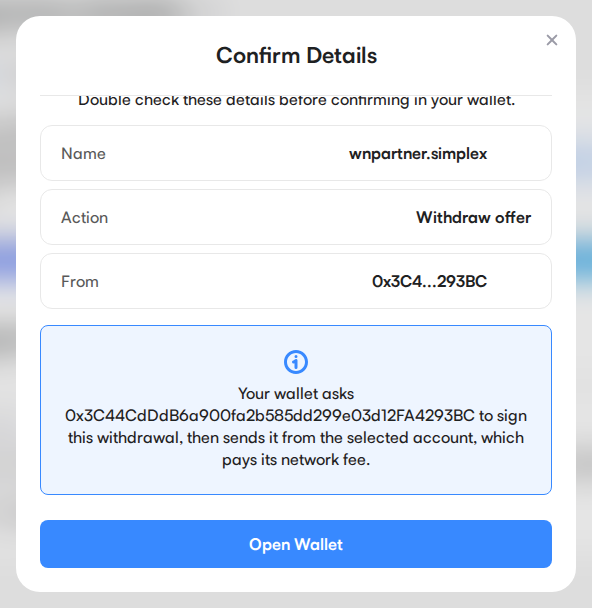
